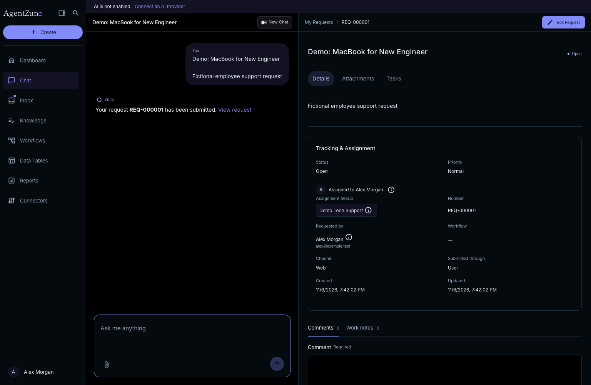
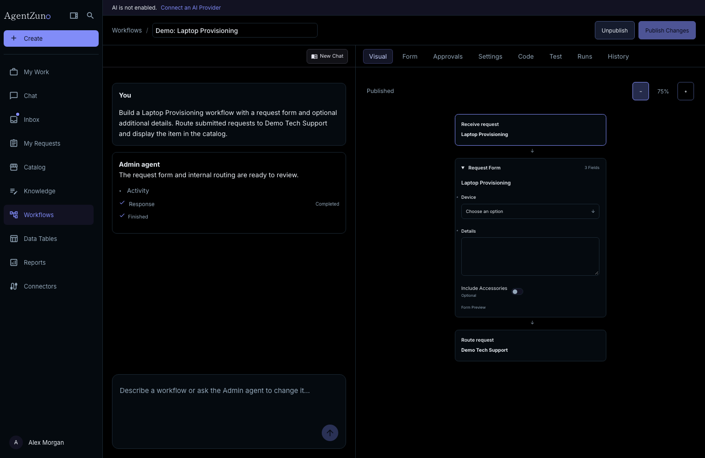

# AgentZuno

AgentZuno is a free, open source conversational AI help desk. It brings employee support, guided requests, executable workflows, shared knowledge, and governance together in a platform teams can host themselves.

> **Alpha:** AgentZuno is under active development. Expect changing features and occasional bugs. Evaluate its permissions, integrations, and deployment before relying on it for sensitive or critical work.

## Why I built this

Seeing the price tags on platforms like ServiceNow, Salesforce, Serval, and Jira got me thinking: if their engineers can use AI to build software, what could one engineer build with the same tools?
AgentZuno started as a side project to find out. I wanted to see how quickly I could build an AI help desk using Codex, my experience with enterprise platforms, and knowing the right questions to ask. I’m sharing the code so anyone can try it, learn from it, and make it their own.

## What it brings together

- **Two agents:** An Admin agent for building workflows and proposing knowledge changes, and Zuno for employee support, with separate permissions.
- **Conversational requests:** Guided forms, a browsable catalog, attachments, and request details alongside the conversation.
- **Executable workflows:** TypeScript, conditional routing, user/group/manager approvals, visual previews, and published revisions.
- **Support work:** My Work dashboards, assigned requests, group queues, request tasks, comments, work notes, and workload reports. Admins and authorized Agents can create and close tasks, including through confirmed Zuno actions.
- **Shared knowledge:** Knowledge bases, topics, articles, reviewed AI proposals, and access controls.
- **Organization data:** Workforce profiles, identity provisioning, reference records, and customizable Data Tables.
- **Connections and governance:** Slack and email support, connector action controls, configurable AI providers, roles, searchable audit records, CSV/JSON exports, and version history.
- **Demo data:** Load removable Tech, Media or Retail records into the current workspace from Settings. Published catalog workflows and knowledge work with your connected AI provider.

AgentZuno is self-hosted and uses MongoDB or PostgreSQL, plus Redis. AI providers, hosting, and third-party services may incur costs. Integration support varies; see [current capabilities and limits](docs/integrations.md).

## Preview

Screenshots use fictional development records.



Build and review a workflow alongside the Admin conversation.



## Get started

See [installation and development](docs/getting-started.md) for the complete setup. After creating `.env` from `.env.example` and setting a private credential encryption key:

```sh
docker compose up --build -d
```

Open [localhost:3000](http://localhost:3000), register an account, and configure an AI provider in Settings. Admins and Agents land on My Work; employees land on Chat.

Deploy on Render with the included [`render.yaml`](render.yaml) Blueprint. See [Render setup and operational requirements](docs/deployment.md#deploy-on-render). This provisions paid services and requires a MongoDB Atlas connection.

## Roles

- **Admin:** Configure the workspace, manage people and groups, build and publish workflows, and review Audit.
- **Agent:** Work on accessible requests and tasks in assigned groups, with comments and internal work notes.
- **User:** Ask for help, browse permitted knowledge and catalog items, and submit and follow requests.
- **Read Only:** Inspect permitted records and reports without changing operational data or running AI conversations.

Approval permission and an explicit assignment are required to decide approvals. Role access does not override private-file or knowledge permissions. See [roles and everyday features](docs/roles-and-features.md) and the [Knowledge guide](docs/knowledge.md) for step-by-step instructions.

## Learn more

The running application includes public documentation at `/docs` and workflow SDK guidance at `/docs/workflows`.

Technical documentation:

- [Installation and development](docs/getting-started.md)
- [Deployment, backups, and recovery](docs/deployment.md)
- [Architecture and workflow execution](docs/architecture.md)
- [Connections and identity](docs/integrations.md)
- [Security and current limits](docs/security.md)
- [Workflow SDK](api/sdk/workflows/README.md)

## Contributing

Issues and focused contributions are welcome. See [AGENTS.md](AGENTS.md) for repository conventions. Keep credentials and private workspace data out of issues and contributions; arrange a private channel with the maintainer for security reports.

## License

[Apache License 2.0](LICENSE). Third-party dependencies retain their respective licenses.

Demo references stay separate from real configuration. Demo removal preserves referenced records as real records and shows these in its confirmation, keeping existing workflows and audit history intact.

Registration collects a name, email address, and password; the name is saved to the user profile.

Database setup now precedes registration. Choose bundled MongoDB/PostgreSQL or a custom connection for the entire installation. See [database setup and operations](docs/databases.md) for token retrieval, storage behavior, security, backups and migration limits.

The public [Try It demo](/demo) uses the exact admin workspace routes, layouts and components, backed by isolated, short-lived in-memory API sessions seeded from fictional fixtures. Visitors can explore predefined conversations, forms, workflows, requests, approvals, knowledge, groups and connectors without registering or invoking an AI provider. Reset Demo discards changes; sessions expire after 30 minutes; real workspace records and integration credentials are never loaded into the demo.

GitHub Pages builds automatically use the configured repository or custom-domain base path. See the [deployment guide](docs/deployment.md#publish-the-website-on-github-pages) for static-site limits and verification.

Fulfillment tasks have editable records and appear in their assignment group’s Inbox. Add tasks from a request or Data Tables → Tasks. Phone layouts use a navigation drawer and a Chat/Details switch; marketing chat illustrations allow page scrolling on touch devices. See the [roles and features guide](docs/roles-and-features.md#fulfillment-tasks).

The production build prerenders the marketing site and public Docs with search metadata and a sitemap. Configure `PUBLIC_SITE_URL` for your public hostname; application routes remain authenticated and excluded from indexing. See [public-page SEO](docs/deployment.md#prerendered-public-pages-and-seo).

The public marketing page links to Docker setup and the GitHub repository. Sign-in and registration links appear only after the backend confirms database setup is complete, including on self-hosted domains. Static website builds do not show these account actions or a Try It button.
