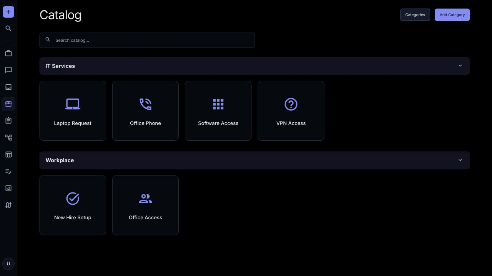
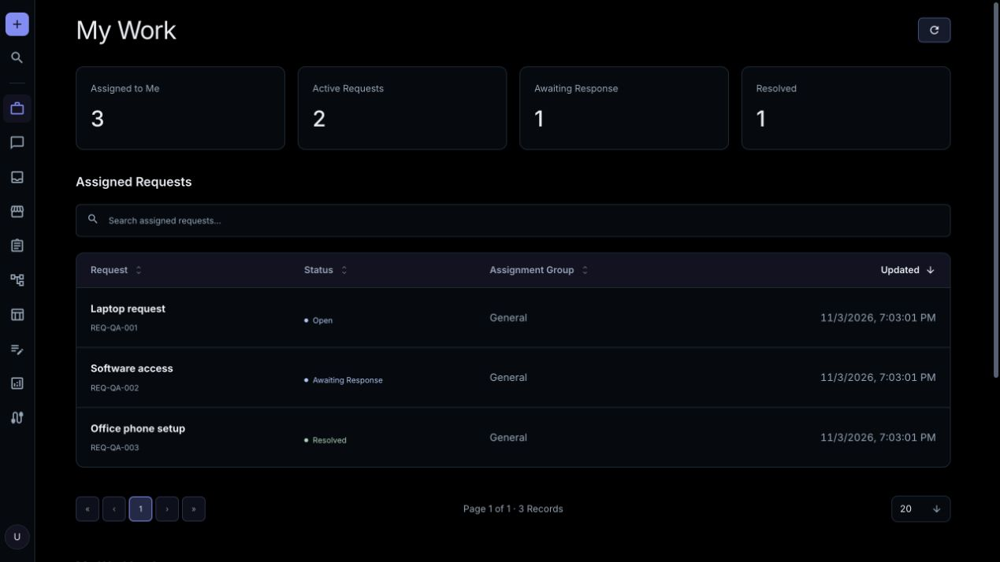

# AgentZuno

AgentZuno is a free, open source conversational AI help desk. It brings employee support, guided requests, executable workflows, shared knowledge, and governance together in a platform teams can host themselves.

> **Alpha:** AgentZuno is under active development. Expect changing features and occasional bugs. Evaluate its permissions, integrations, and deployment before relying on it for sensitive or critical work.

## Why I built this

After years of working with enterprise platforms, I wanted to make everyday service workflows more approachable. Employees should be able to ask for what they need, and support teams should be able to build the process around those requests without a large platform budget.

AgentZuno brings that experience together in something teams can host, inspect, and adapt. The code was generated and refined with AI assistance, including ChatGPT and Codex.

## What it brings together

- **Two agents:** An Admin agent for building workflows and proposing knowledge changes, and Zuno for employee support, with separate permissions.
- **Conversational requests:** Guided forms, a browsable catalog, attachments, and request details alongside the conversation.
- **Executable workflows:** TypeScript, conditional routing, user/group/manager approvals, visual previews, and published revisions.
- **Support work:** My Work dashboards, assigned requests, group queues, comments, work notes, and workload reports.
- **Shared knowledge:** Knowledge bases, topics, articles, reviewed AI proposals, and access controls.
- **Organization data:** Workforce profiles, identity provisioning, reference records, and customizable Data tables.
- **Connections and governance:** Slack and email support, connector action controls, configurable AI providers, roles, searchable audit records, CSV/JSON exports, and version history.
- **Demo data:** Load removable Tech, Media or Retail records into the current workspace from Settings. Published catalog workflows and knowledge work with your connected AI provider.

AgentZuno is self-hosted and uses MongoDB and Redis. AI providers, hosting, and third-party services may incur costs. Integration support varies; see [current capabilities and limits](docs/integrations.md).

## Preview

Screenshots use fictional development records.



Keep assigned work and workload reports together.



## Get started

See [installation and development](docs/getting-started.md) for the complete setup. After creating `.env` from `.env.example` and setting a private credential encryption key:

```sh
docker compose up --build -d
```

Open [localhost:3000](http://localhost:3000), register an account, and configure an AI provider in Settings. Admins and Agents land on My Work; employees land on Chat.

## Learn more

The running application includes public documentation at `/docs` and workflow SDK guidance at `/docs/workflows`.

Technical documentation:

- [Installation and development](docs/getting-started.md)
- [Deployment, backups, and recovery](docs/deployment.md)
- [Architecture and workflow execution](docs/architecture.md)
- [Connections and identity](docs/integrations.md)
- [Security and current limits](docs/security.md)
- [Workflow SDK](api/sdk/workflows/README.md)

## Contributing

Issues and focused contributions are welcome. See [AGENTS.md](AGENTS.md) for repository conventions. Keep credentials and private workspace data out of issues and contributions; arrange a private channel with the maintainer for security reports.

## License

[Apache License 2.0](LICENSE). Third-party dependencies retain their respective licenses.
